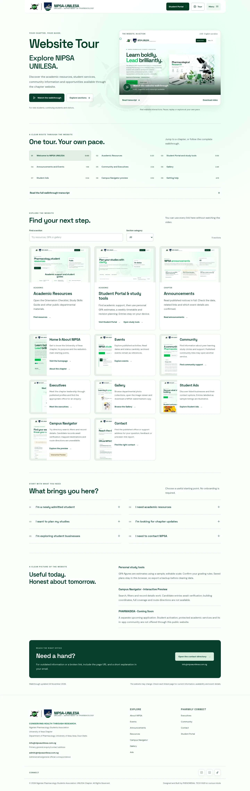
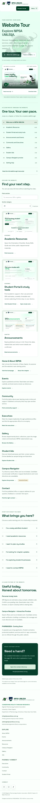

# Guided Canvas — refined Website Tour review

The layout, educational structure, nine chapters and Tour entry points remain provisionally approved. These are updated captures of the actual Next.js feature build after visible images have loaded and decoded. Native lazy loading is preserved.

| Desktop | Smartphone (390 px) |
| --- | --- |
| [Tour full page](desktop-full.webp) | [Tour full page](mobile-full.webp) |
| [Homepage entry](homepage-desktop.webp) | [Homepage entry](homepage-mobile.webp) |

- [Final narrated movie — 48 kHz AAC-LC](../../public/media/website-tour/walkthrough.mp4)
- [Encoding, timing and integrity metadata](media-metadata.json)
- [Instructional footage before/after at 350 px](instructional-comparison.webp)
- [Actual mobile native-player GPA frame, captions off](mobile-player-gpa.webp)
- [Original lazy-loading diagnosis](image-loading-diagnosis.json)
- [Focused change report](../WEBSITE_TOUR_REFINEMENTS.md)
- [Executed validation and limitations](../WEBSITE_TOUR_VALIDATION.md)

The before/after comparison contains genuine movie frames scaled for readability review, rather than a physical-device test. The native-player example uses an ordinary captions-off playback state; captions remain available and default on in the application.

The original Tour PR #7 was already merged before this refinement session. These new refinements have not been merged or deployed and await final publication approval.
